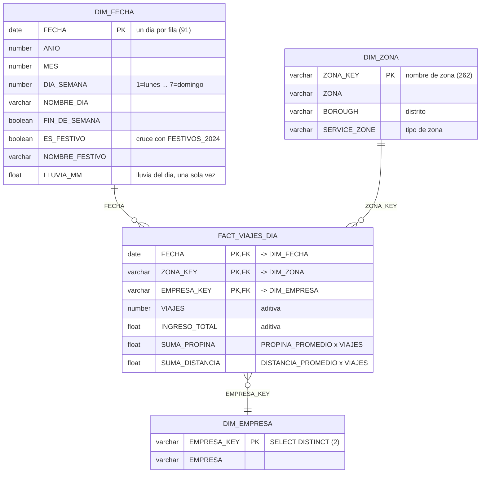

# Diagrama de la estrella · Taller 1

Equipo: Cristian Camilo Hernandez

Grano (el mismo de la primera línea de `01_estrella.sql`): una fila por FECHA, ZONA y EMPRESA (un día de una zona para una empresa). 46 715 filas, igual que el gold `DAILY_ZONE_METRICS`.

La tabla de hechos `FACT_VIAJES_DIA` va al centro y las tres dimensiones la rodean. Cada línea une la clave de la dimensión con la columna del mismo nombre en el hecho: una fila de la dimensión aparece en muchas filas del hecho.

## Claves

| Dimensión | Clave | Por qué es única |
|---|---|---|
| DIM_FECHA | `FECHA` (une con `FACT_VIAJES_DIA.FECHA`) | Se genera un día por fila entre el primer y el último día del gold: 91 días, ninguno repetido. |
| DIM_ZONA | `ZONA_KEY` = nombre de la zona (une con `FACT_VIAJES_DIA.ZONA_KEY`) | El gold identifica la zona por nombre. La DIM_ZONA del Lab 4 repite 2 nombres (Corona; Governor's Island/Ellis Island/Liberty Island), pero cada grupo comparte distrito y tipo de zona, así que `SELECT DISTINCT ZONA, BOROUGH, SERVICE_ZONE` deja una fila por nombre (262). Así la unión no duplica viajes (trampa 4). |
| DIM_EMPRESA | `EMPRESA_KEY` = nombre de la empresa (une con `FACT_VIAJES_DIA.EMPRESA_KEY`) | Se construye con `SELECT DISTINCT EMPRESA` sobre el gold: una fila por empresa (Uber, Lyft), sin escribirlas a mano. |

La lluvia vive solo en `DIM_FECHA` (trampa 1). El hecho guarda medidas aditivas; los promedios ponderados se rehacen con `SUM(SUMA_PROPINA) / SUM(VIAJES)` y `SUM(SUMA_DISTANCIA) / SUM(VIAJES)` (trampa 2).
